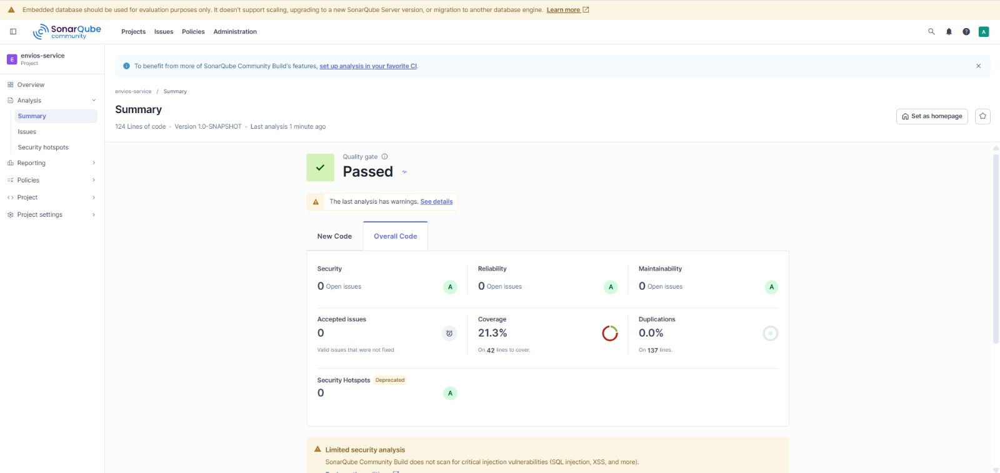
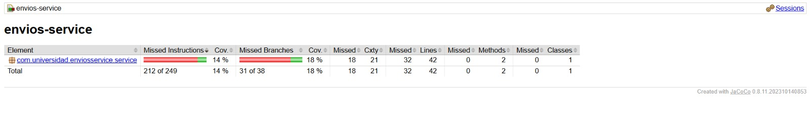

# Envios Service — Análisis de Métricas de Calidad

## Entorno de análisis
**Decisión de diseño 1 (Entorno de análisis):**  
Se eligió **SonarQube local con Docker** frente a SonarCloud por dos criterios técnicos principales:
1. **Independencia y privacidad:** No depende de conectividad externa constante ni está sujeto a los límites de volumen o cuotas de un plan gratuito en la nube; además, el código y las métricas se mantienen de forma privada en el entorno local.
2. **Control total de la configuración:** Permite administrar directamente las reglas, Quality Profiles y Quality Gates en el puerto local 9000 sin restricciones administrativas del proveedor SaaS. Como costo de esta elección, se asume el consumo de memoria RAM y CPU de la máquina anfitriona para mantener el contenedor en ejecución durante el laboratorio.

**Decisión de diseño 2 (Exclusiones del análisis):**  
Se decidió **no excluir ninguna clase** (`sonar.exclusions`) en esta etapa inicial. El proyecto contiene únicamente la clase de lógica de negocio pura (`ServicioCalculoEnvio.java`) sin clases de infraestructura (como clases `Main`, controladores web, DTOs anémicos o configuraciones de frameworks) que pudieran distorsionar artificialmente el porcentaje de cobertura sin aportar valor.

---

## Estado inicial del análisis
| Métrica | Valor real observado |
|---|---|
| Complejidad ciclomática de `calcularCosto()` | 20 |
| Complejidad cognitiva de `calcularCosto()` | 32 |
| Cobertura de líneas de `ServicioCalculoEnvio` | 23.8% (10 de 42 líneas cubiertas) |
| Cobertura de ramas de `ServicioCalculoEnvio` | 18.4% (7 de 38 condiciones cubiertas) |
| Cobertura global reportada por SonarQube | 21.3% |
| Code Smells reportados | 0 |

---

## Interpretación
El diagnóstico estático y dinámico identifica con claridad que el problema del proyecto se concentra exclusivamente en el método `ServicioCalculoEnvio.calcularCosto()`:

1. **Concentración de la problemática:** Con una **complejidad ciclomática de 20** (rango "Alta", al límite de "Crítica" según la clasificación de McCabe), el método acumula múltiples responsabilidades: selección de transporte, cálculo de tramos de peso, recargos por distancia, validaciones de límite de servicio, recargos por fragilidad y descuentos por tipo de cliente.
2. **Ramas sin cubrir en JaCoCo:** De las 38 ramas de decisión condicionales, 31 quedaron completamente sin ejercitar (solo se cubrieron las ramas de envío `ESTANDAR` con peso menor a 5 kg para clientes `REGULAR` y `PREMIUM`). Las ramas de `EXPRESS`, `OVERNIGHT`, `INTERNACIONAL`, tramos de peso medio y alto, excepciones por distancia/método inválido y cliente `CORPORATIVO` quedaron sin probar.
3. **Decisión de diseño 3 (Métrica como señal principal):**  
   Entre Complejidad Ciclomática (CC), Complejidad Cognitiva y Cobertura, se seleccionó la **Complejidad Ciclomática (CC = 20)** como la señal técnica principal para guiar la refactorización. La baja cobertura (18.4%) es solo un síntoma derivado de la alta complejidad: un método con 20 caminos independientes exige como mínimo 20 pruebas unitarias para alcanzar cobertura total de ramas. Atacar únicamente la cobertura escribiendo pruebas sobre un método monolítico perpetuaría la fragilidad del diseño; en cambio, reducir la complejidad ciclomática mediante desacoplamiento modular resolverá la causa raíz y facilitará la creación de pruebas unitarias focalizadas.

---

## Capturas del análisis inicial

