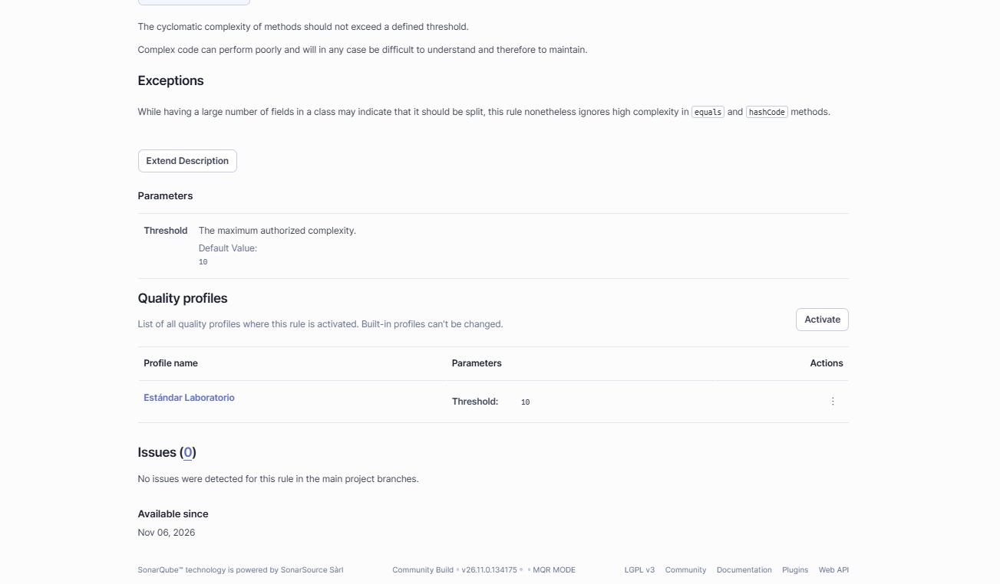
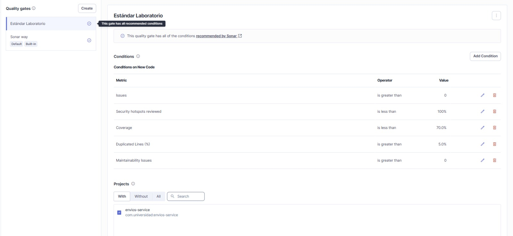
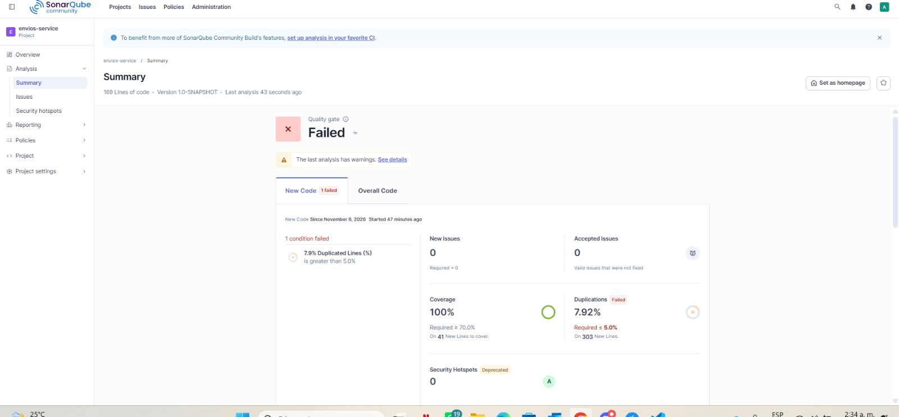
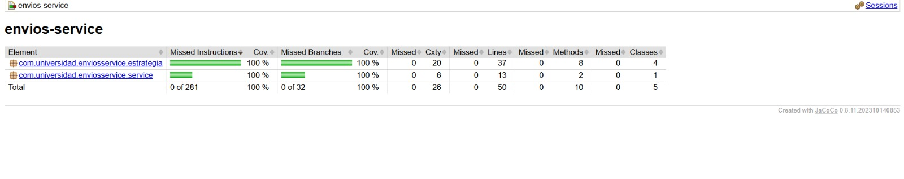

# Envios Service — Diagnóstico y Mejora Guiada por Métricas

**Post-contenido Unidad 10 — Métricas de Calidad y SonarQube: Diagnóstico y Mejora Guiada por Métricas Reales**
Patrones de Diseño de Software · Universidad de Santander (UDES)

Repositorio: `meza-post1-u10` (Parte 1 y Parte 2 en el mismo proyecto Maven, en la raíz).

---

## Estructura del proyecto

```
meza-post1-u10/
├── pom.xml                       ← Java 21, JUnit 5, JaCoCo 0.8.11, sonar-maven-plugin
├── sonar-project.properties      ← configuración comentada del análisis
├── docs/                         ← evidencias (capturas antes/después y configuración)
└── src/
    ├── main/java/com/universidad/enviosservice/
    │   ├── service/
    │   │   └── ServicioCalculoEnvio.java        ← orquestador (CC 20 → 5)
    │   └── estrategia/
    │       ├── EstrategiaEnvio.java             ← interfaz Strategy
    │       ├── EnvioEstandarStrategy.java
    │       ├── EnvioExpressStrategy.java
    │       ├── EnvioOvernightStrategy.java
    │       └── EnvioInternacionalStrategy.java
    └── test/java/com/universidad/enviosservice/
        ├── service/ServicioCalculoEnvioTest.java
        └── estrategia/  (una clase de prueba por estrategia)
```

---

# Parte 1 — Diagnóstico con métricas reales

## Entorno de análisis

SonarQube Community Build ejecutado **localmente con Docker** (`sonarqube:community`, `http://localhost:9000`), proyecto `envios-service` con project key `com.universidad:envios-service`. La justificación está en la **Decisión de diseño 1**.

```bash
docker run -d --name sonarqube -p 9000:9000 -e SONAR_ES_BOOTSTRAP_CHECKS_DISABLE=true sonarqube:community
mvn clean verify sonar:sonar -Dsonar.token=TU_TOKEN
```

## Estado inicial del análisis

Valores tomados del primer análisis real (dashboard de SonarQube y reporte HTML de JaCoCo, capturas abajo):

| Métrica | Valor real observado |
|---------|----------------------|
| Complejidad ciclomática de `calcularCosto()` | **20** |
| Complejidad cognitiva de `calcularCosto()` | 32 |
| Cobertura de líneas de `ServicioCalculoEnvio` | **23.8%** (10 de 42 líneas; JaCoCo: 32 líneas sin cubrir) |
| Cobertura de ramas de `ServicioCalculoEnvio` | **18.4%** (7 de 38 ramas; JaCoCo: 31 ramas sin cubrir) |
| Cobertura de instrucciones (JaCoCo) | 14% (212 de 249 sin cubrir) |
| Cobertura global (SonarQube) | 21.3% |
| Code Smells reportados | **0** |
| Duplicated Lines (%) | 0.0% |

> **Nota sobre los 0 Code Smells:** el primer análisis usó el perfil por defecto *Sonar Way*, que **no activa** la regla S1541 (*Cyclomatic Complexity of methods should not exceed the authorized threshold*). Por eso un método con CC = 20 no aparece como Code Smell: la métrica existe en *Measures → Complexity*, pero ninguna regla la convierte en issue. Esto motivó configurar el Quality Profile "Estándar Laboratorio" en la Parte 2.
>
> **Coherencia CC ↔ código:** JaCoCo reporta `Cxty = 21` para la clase: 20 de `calcularCosto()` + 1 del constructor por defecto. Contado con la fórmula de la Sección 3.1 (CC = 1 + puntos de decisión): 4 comparaciones de `metodoEnvio` + 12 condiciones internas (3 por método: tramos de peso, recargo por distancia o límite de OVERNIGHT) + `esFragil` + 2 de `tipoCliente` = 19 decisiones → CC = 20. Esto también cuadra con JaCoCo: 19 decisiones binarias = 38 ramas.

## Interpretación

1. **Método que concentra el problema:** `ServicioCalculoEnvio.calcularCosto()` es el único método con lógica y concentra todas las responsabilidades: seleccionar el método de envío, calcular el tramo de peso, aplicar recargos por distancia, validar el límite de OVERNIGHT, aplicar fragilidad y descuentos por cliente. Su CC = 20 lo ubica en el tope del rango "Alta" (11–20) de la Tabla 3.2.
2. **Ramas que JaCoCo dejó sin cubrir (en rojo/amarillo):** la suite inicial solo recorre `ESTANDAR` con peso ≤ 5 kg, 100 km, no frágil, para clientes `REGULAR` y `PREMIUM`. Quedaron sin ejercitar:
   - Las ramas completas de `EXPRESS`, `OVERNIGHT` e `INTERNACIONAL` (con sus tres tramos de peso cada una).
   - Los tramos `5 < peso ≤ 20` y `peso > 20` de `ESTANDAR`.
   - Los recargos por distancia (`> 500 km` en ESTANDAR/EXPRESS, `> 5000 km` en INTERNACIONAL).
   - La excepción de OVERNIGHT para `distanciaKm > 300` y la excepción de método no soportado.
   - El recargo por `esFragil = true` y el descuento `CORPORATIVO`.
3. **¿Complejidad y cobertura apuntan al mismo método?** Sí. Coinciden porque la clase tiene un único método con lógica: los 20 caminos independientes viven en `calcularCosto()`, y la suite de dos pruebas solo recorre 2 de ellos. La baja cobertura es consecuencia directa de que el método tiene demasiados caminos para una suite mínima (ver Decisión de diseño 3).

## Capturas del análisis inicial


---

# Decisiones de diseño

### 1. Entorno de análisis: SonarQube local con Docker

Se eligió **SonarQube Community Build en Docker** en lugar de SonarCloud según dos criterios de la tabla del Paso 1:

- **Control total de la configuración y sin límites de plan:** el laboratorio exige duplicar *Sonar Way*, activar y parametrizar la regla S1541 y crear un Quality Gate propio. En la instancia local el usuario es administrador y puede hacerlo sin depender de permisos de organización ni de restricciones del plan gratuito.
- **Sin dependencia de conectividad ni exposición pública:** el análisis se ejecuta contra `localhost:9000`, sin requerir internet durante el laboratorio, y los resultados no quedan visibles públicamente (en SonarCloud los proyectos públicos son visibles para cualquiera).
- **Costo asumido:** el contenedor consume RAM y CPU de la máquina y debe permanecer encendido durante ambas partes; la instancia usa la base de datos embebida (aviso visible en la captura), aceptable para un laboratorio pero no para producción.

### 2. Exclusiones del análisis: ninguna

No se declaró `sonar.exclusions` (queda documentado como comentario en `sonar-project.properties`). El proyecto es un módulo Maven plano sin clase `Main`, controladores, DTOs ni configuración: todas las clases contienen lógica de negocio (`ServicioCalculoEnvio` y las estrategias), así que excluir alguna ocultaría código que sí debe medirse. Las pruebas no se excluyen porque `sonar.tests` ya las clasifica como código de test, que no suma líneas a cubrir.

### 3. Métrica usada como señal principal: Complejidad Ciclomática

SonarQube expone tres señales para `calcularCosto()`: Cyclomatic Complexity = 20, Cognitive Complexity = 32 y cobertura de ramas = 18.4%. Se eligió la **Complejidad Ciclomática** como señal principal por tres razones:

- **Es causa, no síntoma:** la CC es el número de caminos linealmente independientes, es decir, la cantidad mínima de casos de prueba para cubrir todas las ramas. Con CC = 20 y una suite de 2 pruebas, la cobertura del 18.4% es consecuencia previsible. Usar la cobertura como señal principal habría llevado a escribir 18 pruebas más sobre un método monolítico sin mejorar el diseño.
- **Es la métrica que el patrón reduce de forma medible:** los patrones candidatos (Strategy, State, Chain of Responsibility) eliminan condicionales, y la CC los cuenta directamente. La meta de la Parte 2 (≥ 50% de reducción) se expresa en esa métrica.
- **Cognitive Complexity como señal secundaria:** su valor (32) confirma el diagnóstico, pero penaliza el anidamiento y la legibilidad. Aquí el problema de fondo es la cantidad de ramas por método de envío, no la profundidad del anidamiento.

### 4. Patrón elegido: Strategy

Se analizó la naturaleza de los condicionales de `calcularCosto()` con la tabla del Paso 7:

- **Se descarta State:** `ServicioCalculoEnvio` no tiene campos mutables. No recuerda nada entre llamadas y no existen transiciones (un envío no "pasa" de ESTANDAR a EXPRESS). El comportamiento depende solo de los parámetros de cada llamada, no de un estado interno.
- **Se descarta Chain of Responsibility:** las ramas de `metodoEnvio` son mutuamente excluyentes (comparaciones de igualdad sobre un valor discreto). Solo una puede aplicar, el orden de evaluación no altera el resultado y ningún manejador procesa parcialmente la solicitud antes de pasarla al siguiente.
- **Se elige Strategy:** cada rama calcula el mismo tipo de resultado (costo base a partir de `pesoKg` y `distanciaKm`) con una fórmula propia, elegida una sola vez por el valor de `metodoEnvio`. Es la señal exacta de Strategy en la tabla: algoritmos intercambiables seleccionados por un valor discreto.

**Qué se movió y qué se quedó en el orquestador:**

| Responsabilidad | Ubicación tras el refactor | Motivo |
|---|---|---|
| Tramos de peso, recargo por distancia, factor 1.3 de EXPRESS | Cada `Envio*Strategy` | Es la fórmula específica del método de envío |
| Límite de 300 km de OVERNIGHT (`IllegalArgumentException`) | `EnvioOvernightStrategy` | Regla exclusiva de ese método |
| Selección de la estrategia | `Map.of(...)` inmutable en `ServicioCalculoEnvio` | Sustituye la cadena `if/else if` de `metodoEnvio` |
| Método no soportado | Orquestador (`estrategia == null`) | Es un problema de selección, no de cálculo |
| Recargo frágil (+15%) y descuentos `PREMIUM`/`CORPORATIVO` | Orquestador | Reglas transversales a los 4 métodos; ponerlas en cada estrategia duplicaría la lógica 4 veces (violación de DRY) |

**Resultado:** `calcularCosto()` pasa de CC = 20 a **CC = 5** (1 base + estrategia nula + `esFragil` + 2 ramas de `tipoCliente`), en el rango "Moderada" de la Tabla 3.2. Cada estrategia queda con **CC = 4**, lo que se verifica en el reporte JaCoCo final: el paquete `estrategia` suma `Cxty = 20` = 4 métodos `calcular()` × 4 + 4 constructores × 1. Para confirmar que la refactorización no cambió el comportamiento, se comparó la versión original con la refactorizada en 4,290 combinaciones de entrada (5 métodos × 3 tipos de cliente × 11 pesos × 13 distancias × fragilidad), con resultados idénticos, incluidas las excepciones.

### 5. Criterio de pruebas agregadas

Cada prueba nueva corresponde a una rama que el reporte JaCoCo de la Parte 1 mostró en rojo, o a un **valor límite** de una condición (`<=` vs `>`), donde suelen ocurrir los errores de frontera. Ninguna prueba repite un camino ya cubierto sin verificar un valor distinto.

| Rama sin cubrir en la Parte 1 | Prueba que la cubre | Casos |
|---|---|---|
| Tramos de peso de ESTANDAR (5–20 kg, > 20 kg) | `EnvioEstandarStrategyTest.calculaCostoPorTramosDePeso` (`@ParameterizedTest` + `@CsvSource`) | 3 / 10 / 25 kg y límites exactos 5 y 20 kg |
| Recargo ESTANDAR `> 500 km` | `aplicaRecargoDistanciaMayorA500` / `noAplicaRecargoEnElLimiteExactoDe500Km` | 600 km (recargo) y 500 km (sin recargo) |
| Rama completa EXPRESS + factor 1.3 | `EnvioExpressStrategyTest` (parametrizada) | 3 / 5 / 10 / 20 / 25 kg |
| Recargo EXPRESS `> 500 km` | `aplicaRecargoDistanciaMayorA500` / `noAplicaRecargoEnElLimiteExactoDe500Km` | 600 km y 500 km |
| Rama completa OVERNIGHT | `EnvioOvernightStrategyTest` (parametrizada) | 3 / 5 / 8 / 20 / 25 kg |
| Excepción OVERNIGHT `> 300 km` | `rechazaDistanciasMayoresA300Km` / `aceptaDistanciaExactamenteDe300Km` | 301 km (excepción) y 300 km (permitido) |
| Rama completa INTERNACIONAL | `EnvioInternacionalStrategyTest` (parametrizada) | 3 / 5 / 10 / 20 / 25 kg |
| Recargo INTERNACIONAL `> 5000 km` | `aplicaRecargoDistanciaMayorA5000` / `noAplicaRecargoEnElLimiteExactoDe5000Km` | 6000 km y 5000 km |
| `esFragil = true` | `ServicioCalculoEnvioTest.aplicaRecargoPaqueteFragil` | 50 × 1.15 = 57.5 |
| Cliente `CORPORATIVO` | `aplicaDescuentoClienteCorporativo` | 50 × 0.85 = 42.5 |
| Orden de reglas transversales | `combinaRecargoFragilYDescuentoCorporativoEnOrden` | 50 × 1.15 × 0.85 = 48.875 |
| Método no soportado | `rechazaMetodoEnvioNoSoportado` | `"DRON"` → `IllegalArgumentException` |

Los valores esperados se calcularon a mano desde las fórmulas originales (el cálculo está en el comentario de cada caso). Por ejemplo, el ejemplo de referencia de la guía para OVERNIGHT con 25 kg indica 250.0, pero la fórmula da `100×2.0 + 20 + 15×2.5 + 5×3.0 = 272.5`. Se usó el valor correcto, y la prueba lo verifica.

### 6. Realismo del Quality Gate

**Quality Profile "Estándar Laboratorio"** (copia de *Sonar Way*, Java): regla **S1541** activada con `Threshold = 10` y asignada al proyecto en *Project Settings → Quality Profile*.

**Quality Gate "Estándar Laboratorio"** (asignado en *Project Settings → Quality Gate*):

Todas las condiciones aplican sobre **código nuevo** (*Conditions on New Code*), como muestra la captura:

| Condición | Falla si | Origen | Qué controla |
|---|---|---|---|
| Coverage | < 70% | Exigida por la guía | Cobertura mínima del código nuevo |
| Issues (equivale a *New Code Smells*) | > 0 | Exigida por la guía | Bloquea cualquier método nuevo o modificado con CC > 10 (vía S1541) u otro issue del perfil |
| Duplicated Lines (%) | > 5% | Exigida por la guía | Duplicación máxima |
| Maintainability Issues | > 0 | Heredada de las recomendadas por Sonar | Refuerza la condición de Issues para problemas de mantenibilidad (incluida S1541) |
| Security Hotspots Reviewed | < 100% | Heredada de las recomendadas por Sonar | No afecta el resultado: el proyecto tiene 0 hotspots |

Se conservaron las dos condiciones recomendadas por Sonar porque no contradicen las tres de la guía y la interfaz indica que el gate cumple "all of the conditions recommended by Sonar".

SonarQube no permite una condición de Quality Gate "CC por método": las condiciones operan sobre métricas agregadas. Por eso el límite por método vive en el Quality Profile (S1541) y el Quality Gate lo hace cumplir indirectamente con "New Issues > 0".

- **¿Por qué CC = 10 (y no 5 ni 20)?** En la Tabla 3.2 de la guía, 10 es el techo del rango "Moderada" (aceptable, requiere atención al agregar lógica); de 11 a 20 la complejidad es "Alta" (difícil de probar, refactorizar). 10 es además el valor por defecto de S1541. Con **5**, el propio orquestador (CC = 5, ya en rango "Moderada") quedaría al límite y se forzaría a fragmentar métodos cohesivos sin ganancia real. Con **20**, el `calcularCosto()` original (CC = 20) pasaría el control, que es justamente el método que este laboratorio debía detectar.
- **¿Por qué 70% de cobertura (y no 100%)?** La Sección 2.3 de la guía advierte que exigir 100% genera incentivos perversos: pruebas triviales sin aserciones útiles solo para llenar el número (Ley de Goodhart). 70% es el mismo umbral de referencia `LINE` que usa la guía para JaCoCo (Sección 2.2). Obliga a probar la lógica de negocio y deja margen para código de infraestructura o defensivo. En este proyecto la cobertura llegó a 100% por pruebas con aserciones sobre valores calculados, no por perseguir la meta.

**Evidencia de la configuración:**





---

# Parte 2 — Comparación antes / después

| Métrica | Antes (Parte 1) | Después (Parte 2) | Cambio |
|---------|------------------|--------------------|--------|
| Complejidad ciclomática de `calcularCosto()` | 20 | **5** | **−75%** (meta: ≥ 50%) |
| CC máxima por método en el proyecto | 20 | 5 (orquestador); 4 cada estrategia | Todos ≤ 10 (S1541) |
| Complejidad cognitiva de `calcularCosto()` | 32 | 4 | −87.5% |
| Cobertura de ramas de la lógica de envío | 18.4% (7/38) | **100%** (32/32) | **+81.6 puntos porcentuales** (meta: ≥ 15) |
| Cobertura de líneas de la lógica de envío | 23.8% (10/42) | 100% (50/50) | +76.2 p.p. |
| Cobertura global (SonarQube) | 21.3% | 100% | +78.7 p.p. |
| Code Smells | 0 (perfil *Sonar Way*, S1541 inactiva) | 0 (perfil "Estándar Laboratorio", S1541 = 10) | Sin issues |
| Duplicated Lines (%) | 0.0% | 7.92% | +7.92 p.p. |
| Quality Gate | — (*Sonar Way* por defecto: Passed) | **Failed** ("Estándar Laboratorio") | 1 condición falla: duplicación |

## Resultado del Quality Gate: Failed (condición identificada)

El segundo análisis cumple todas las condiciones del Quality Gate "Estándar Laboratorio" excepto una (la captura final muestra "1 condition failed"):

- **Coverage:** 100% ≥ 70%.
- **New Issues:** 0. Ningún método supera CC = 10 (orquestador 5, estrategias 4), así que S1541 no reporta nada.
- **Duplicated Lines (%): 7.9% > 5.0%.** Es la única condición que falla.

**Por qué falla:** el detector de duplicación de SonarQube compara secuencias de tokens normalizadas, sin tener en cuenta los valores literales. Las cuatro estrategias repiten la misma estructura de tramos de peso (`if (pesoKg <= 5) … else if (pesoKg <= 20) … else …` más el `if` de recargo por distancia), con distintos coeficientes. Para el analizador, esos bloques son el mismo código. La duplicación es un efecto directo de aplicar Strategy tal como se planteó: se separaron los algoritmos, pero los cuatro comparten la misma forma.

**Cómo se resolvería (remediación identificada):** extraer la estructura común a un método reutilizable parametrizado por tarifas. Por ejemplo, una clase abstracta `EstrategiaPorTramosDePeso` (Template Method) o un objeto de valor `TarifaPorTramos(tarifaKm, cargoBase, tarifaTramo2, tarifaTramo3)` que calcule los tres tramos una sola vez. Cada estrategia declararía solo sus coeficientes y su regla particular (factor 1.3, límite de 300 km, recargo por distancia). Así la duplicación bajaría de 5%, se mantendría el patrón Strategy y la CC por estrategia bajaría. No se aplicó en esta entrega para que la implementación quedara alineada con la referencia de la guía y para dejar documentado, con evidencia real, el *trade-off* entre separar responsabilidades y el aumento de la duplicación estructural que mide el analizador.

---

## Capturas

### Análisis inicial (Parte 1)


### Análisis final (Parte 2)





---

## Cómo reproducir

```bash
# 1. Levantar SonarQube local
docker start sonarqube        # o el docker run de la sección "Entorno de análisis"

# 2. Compilar, ejecutar pruebas y generar el reporte JaCoCo
mvn clean verify              # → target/site/jacoco/index.html y jacoco.xml

# 3. Enviar el análisis a SonarQube
mvn sonar:sonar -Dsonar.token=TU_TOKEN
```

> El scanner de Maven (`mvn sonar:sonar`) toma la configuración de `<properties>` en `pom.xml`. `sonar-project.properties` contiene la misma configuración, comentada, para el scanner standalone y como referencia de la guía.

## Herramientas utilizadas

- Java 21 (OpenJDK), Apache Maven 3.9+
- JUnit Jupiter 5.10.2 (`@Test`, `@ParameterizedTest`, `@CsvSource`)
- JaCoCo 0.8.11 (`prepare-agent` + `report`)
- SonarQube Community Build (`sonarqube:community`) en Docker, `sonar-maven-plugin` 3.11.0.3922
- Git, GitHub

## Conclusiones

La complejidad ciclomática y la cobertura de ramas resultaron ser señales complementarias. SonarQube mostró que `calcularCosto()` tenía CC = 20 y JaCoCo que el 81.6% de sus ramas no se probaba; ambas apuntaban al mismo método porque concentraba toda la lógica. Analizar la naturaleza de los condicionales (sin estado, sin cadena de responsables, una fórmula por valor discreto) permitió elegir Strategy con argumentos y no por intuición: la CC del método bajó 75% (de 20 a 5) y las reglas transversales se mantuvieron en el orquestador para no duplicarlas. La separación en estrategias hizo posibles pruebas parametrizadas pequeñas y verificables, y la cobertura de ramas subió de 18.4% a 100% con pruebas que comprueban valores y límites concretos. El Quality Gate falló por 7.92% de duplicación estructural entre estrategias, lo que muestra que una mejora en una métrica puede empeorar otra, y que un Quality Gate realista sirve para hacer visibles esos *trade-offs* y planear su remediación.